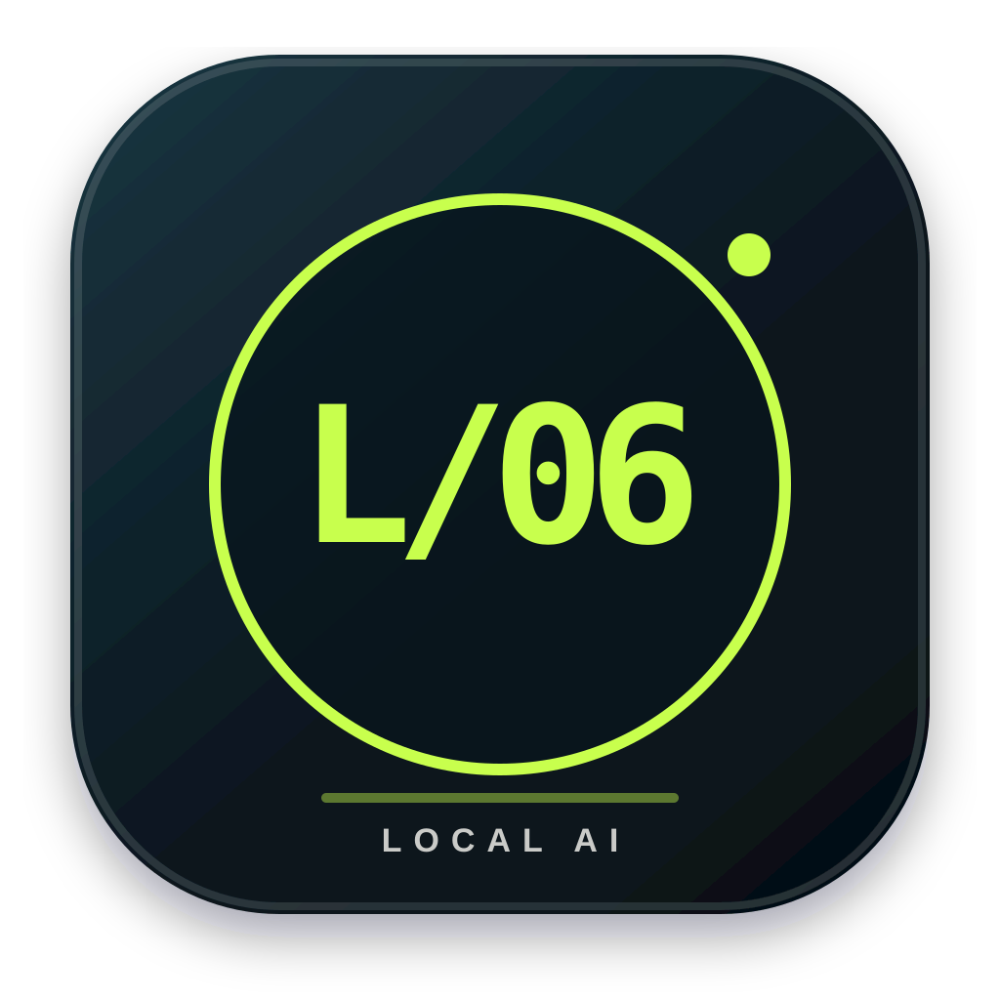
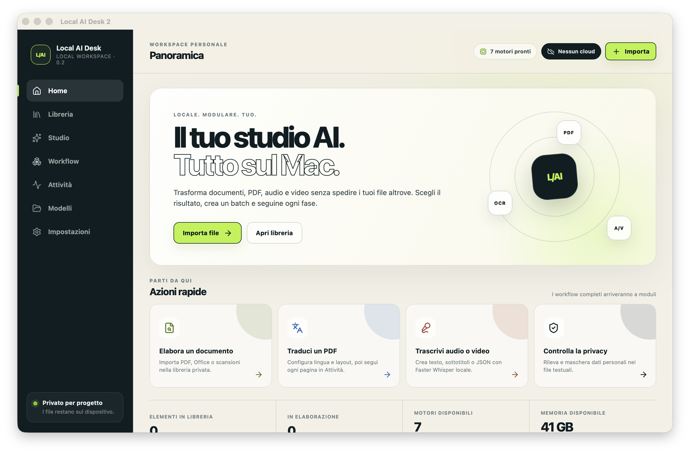
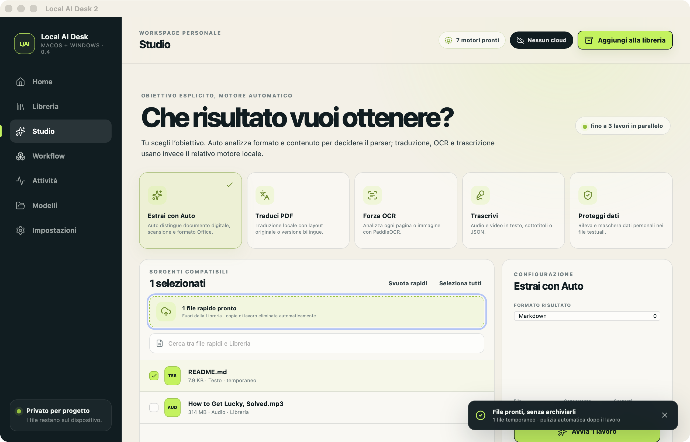
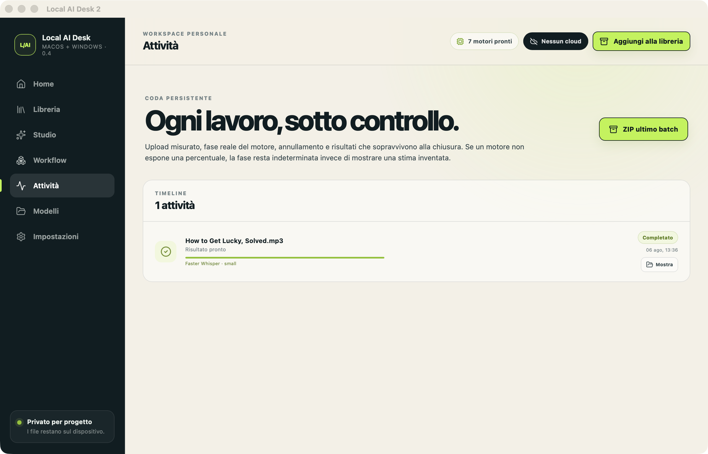

<p align="center">
  
</p>

<h1 align="center">Local AI Desk</h1>

<p align="center">
  <strong>Dal file al risultato. Senza lasciare il tuo computer.</strong><br>
  Un solo workspace open source per documenti, OCR, traduzione PDF,<br>
  trascrizione e protezione dei dati — su macOS e Windows.
</p>

<p align="center">
  <a href="https://github.com/eliagentili/local-ai-desk/releases/latest/download/Local-AI-Desk-macOS-Apple-Silicon.dmg"></a>
  <a href="https://github.com/eliagentili/local-ai-desk/releases/latest/download/Local-AI-Desk-Windows-x64-Setup.exe"></a>
</p>

<p align="center">
  macOS 14+ · Windows 10/11 x64 · Gratis e open source · Nessun account
</p>

<p align="center">
  <a href="https://github.com/eliagentili/local-ai-desk/actions/workflows/desktop.yml?query=branch%3Amain+event%3Apush"></a>
  <a href="https://github.com/eliagentili/local-ai-desk/actions/workflows/security.yml"></a>
  <a href="LICENSE"></a>
</p>



## L'AI locale, finalmente semplice

Non dovresti conoscere modelli, dipendenze o comandi da terminale per lavorare
in privato. Scegli il risultato; Local AI Desk instrada il file verso il motore
locale adatto, mostra ogni fase e raccoglie gli output.

| Privato per progetto | Un flusso, molti motori | File grandi davvero |
| --- | --- | --- |
| Elaborazione sul dispositivo, nessun upload esterno e nessun token AI. | Auto, OCR, traduzione, trascrizione e Privacy Shield nella stessa interfaccia. | Streaming su disco, batch paralleli e nessun limite artificiale di 500 MB. |

## Trascina. Scegli. Ottieni.

1. **Trascina uno o più file.** Il Drop rapido non li aggiunge alla Libreria e
   non calcola hash inutili, anche se sono video da molti GB.
2. **Scegli il risultato.** Auto riconosce il percorso di estrazione; puoi anche
   richiedere esplicitamente traduzione, OCR, trascrizione o protezione dati.
3. **Segui il lavoro.** Progresso, fase, concorrenza e annullamento sono sempre
   visibili. Al termine apri il risultato o scarica l'intero batch in uno ZIP.

Le copie usate per il trasferimento locale vengono eliminate automaticamente al
termine, in caso di errore e dopo un annullamento. Gli originali non vengono mai
modificati. Rimangono soltanto i risultati che hai scelto di creare.



## Cinque obiettivi, una sola scrivania

| Obiettivo | Cosa ottieni | Motore locale |
| --- | --- | --- |
| **Estrai con Auto** | Markdown o testo da PDF, Office e molti altri formati | Router locale + MarkItDown / OCR |
| **Traduci PDF** | PDF tradotto o bilingue con layout, immagini e formule | PDFMathTranslate 2 + TranslateGemma |
| **Forza OCR** | Markdown, testo o JSON da scansioni e immagini | PaddleOCR / GLM-OCR |
| **Trascrivi** | Testo, sottotitoli SRT o JSON da audio e video | Faster Whisper |
| **Proteggi dati** | Testo mascherato o JSON con i rilevamenti | Presidio + regole italiane |



## Drop rapido o Libreria? Decidi tu

Il **Drop rapido** è il percorso predefinito per un lavoro usa-e-getta: la
sorgente resta fuori dal database e sparisce dallo Studio quando il batch parte.

La **Libreria** è opzionale e serve quando vuoi ritrovare una fonte nel tempo.
Conserva solo percorso, metadati e hash BLAKE3: non crea una seconda copia del
file. Puoi rimuovere il riferimento in qualsiasi momento senza cancellare
l'originale o i risultati.

## Costruita per essere affidabile

- app desktop nativa con Tauri 2 e React 19;
- coda persistente e scheduler fino a tre lavori concorrenti;
- importazione e drop multipli tramite controlli nativi macOS/Windows;
- upload in streaming e hash BLAKE3 incrementale, senza caricare file enormi in RAM;
- avanzamento reale quando il motore lo espone e stato onesto negli altri casi;
- annullamento per singolo lavoro o per tutto il batch;
- risultati atomici e ZIP con manifest JSON;
- runtime e motori in background, senza finestre Terminal o PowerShell;
- dati, modelli e cache nel profilo dell'utente;
- aggiornamenti firmati Ed25519 con controllo automatico, progresso e riavvio esplicito;
- CSP restrittiva, CI multipiattaforma, CodeQL, SBOM e checksum di release;
- interfaccia responsive, utilizzabile da tastiera e rispettosa del movimento ridotto.

Pausa/ripresa, retry, notifiche, preview/editor e workflow visuali sono nella
[roadmap](docs/ROADMAP.md). Le funzioni non complete non vengono presentate come
se lo fossero.

## Download della beta

I link puntano sempre all'ultima versione pubblicata:

- [macOS 14+ Apple Silicon — DMG](https://github.com/eliagentili/local-ai-desk/releases/latest/download/Local-AI-Desk-macOS-Apple-Silicon.dmg)
- [Windows 10/11 x64 — installer EXE](https://github.com/eliagentili/local-ai-desk/releases/latest/download/Local-AI-Desk-Windows-x64-Setup.exe)
- [Windows 10/11 x64 — pacchetto MSI](https://github.com/eliagentili/local-ai-desk/releases/latest/download/Local-AI-Desk-Windows-x64.msi)
- [Note, versioni precedenti e altri asset](https://github.com/eliagentili/local-ai-desk/releases)
- [Checksum SHA-256](https://github.com/eliagentili/local-ai-desk/releases/latest/download/SHA256SUMS.txt)

Dalla **0.5**, l’app controlla in autonomia le nuove release dopo l’avvio e poi
periodicamente. Decide sempre l’utente quando scaricare e riavviare; se un lavoro
è attivo, l’installazione resta in attesa. Il pacchetto viene accettato soltanto
se supera la verifica della firma Ed25519. Per passare dalla 0.4 o precedente
alla 0.5 serve un ultimo download manuale dai pulsanti qui sopra.

La prima release pubblica è una **beta**. Ogni release contiene installer,
manifest updater firmato, firme separate, SBOM SPDX e checksum. Prima di
installare considera questi limiti:

- macOS usa una firma ad-hoc e può richiedere l'autorizzazione in **Privacy e sicurezza**;
- Windows può mostrare SmartScreen perché manca ancora una firma Authenticode;
- il primo setup dei motori può superare 20 GB e richiede Internet;
- modelli e dipendenze non sono inclusi nell'installer e conservano le licenze originali;
- per file non fidati consulta prima [SECURITY.md](SECURITY.md).

## Runtime locale

Al primo avvio, **Modelli → Installa motori** prepara l'ambiente nel profilo
dell'utente e scarica i componenti da origini ufficiali. L'operazione prosegue
in background. L'app usa soltanto il loopback `127.0.0.1` e termina alla chiusura
i soli processi che ha avviato.

- macOS: `~/Library/Application Support/it.local.localaidesk2/engine`
- Windows: `%APPDATA%\it.local.localaidesk2\engine`

## Sviluppo

Servono Node.js 20+, Rust stable e gli strumenti nativi della piattaforma:
Xcode Command Line Tools su macOS; Microsoft C++ Build Tools e WebView2 su
Windows.

```bash
npm install
npm run tauri dev
```

Controlli locali:

```bash
npm run build
cd src-tauri
cargo fmt --check
cargo test
cargo clippy --all-targets -- -D warnings
```

Build macOS:

```bash
npm run tauri build -- --bundles app,dmg
```

Build Windows, da Windows:

```powershell
npm ci
npm run tauri build -- --bundles nsis,msi
```

Il workflow [desktop.yml](.github/workflows/desktop.yml) ripete test e build su
runner nativi per entrambe le piattaforme.

## Documentazione

- [Visione di prodotto](docs/PRODUCT.md)
- [Architettura e ciclo di vita dei dati](docs/ARCHITECTURE.md)
- [Ricerca tecnica e scelte dei motori](docs/RESEARCH.md)
- [Roadmap](docs/ROADMAP.md)
- [Sicurezza](SECURITY.md) e [privacy](PRIVACY.md)
- [Licenze di terze parti](THIRD_PARTY_NOTICES.md)
- [Come contribuire](CONTRIBUTING.md)

## Licenza

Local AI Desk è gratuito e distribuito con licenza
[AGPL-3.0-or-later](LICENSE). Motori, modelli e dipendenze conservano le proprie
condizioni, riepilogate in [THIRD_PARTY_NOTICES.md](THIRD_PARTY_NOTICES.md).
